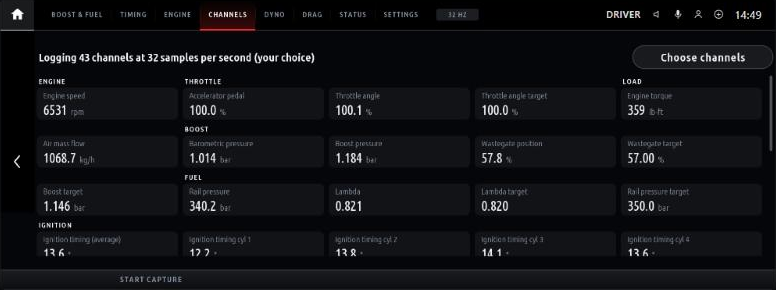
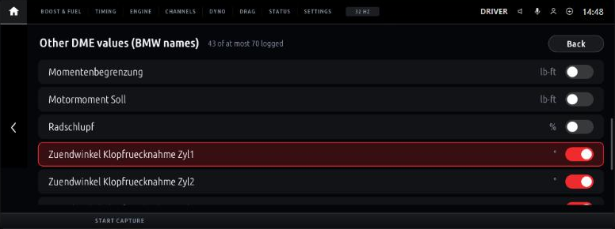

# Boostline for iDrive 7

**[Boostline](https://github.com/clucraft/Boostline)'s ECU logger, road dyno and drag timer running on the BMW iDrive 7 (MGU) head unit itself.** No laptop, phone, ENET cable or WiFi adapter: the head unit reads the engine computer (DME) over its own diagnostic link and shows live values, power curves and times on the centre display.

> **Status: proof of concept, not yet run on a car.** Everything below works in the emulator on a PC. Whether the real head unit passes Boostline's fast logging requests, and how fast it answers, is what the first test on a car has to show. See [What still needs a car](#what-still-needs-a-car).

> **Your iDrive 7 head unit must be rooted to use this.** BMW's head unit only runs apps BMW installs, so Boostline can only be installed on a unit you have root (SSH) access to. Rooting is done with the community tool [idrive7-8-ssh-root](https://github.com/cauliflowermossgrape/idrive7-8-ssh-root). It can wipe the head unit's coding, delete BMW Digital Key pairings and, at worst, brick the unit. Read [Rooting your head unit](#rooting-your-head-unit) before you start. The emulator on a PC needs no root.


Boostline is an independent community project. It is not affiliated with or endorsed by BMW. All trademarks belong to their owners.

---

## What it does

### Live data

- **Live tiles** on three pages (*Boost & fuel*, *Timing*, *Engine*):
  - Each tile shows the current value and a 12-second trace.
  - Actual/target pairs share a tile with a deviation bar: boost, lambda, rail pressure, wastegate, throttle and VANOS.
  - Values are shown in the units you pick (see [Units](#units)).
- **Channels page:** every channel being logged, with its live value. **Choose channels** picks what is logged, from everything your car offers (see [Choosing what to log](#choosing-what-to-log)).
- **Start capture** writes a Boostline CSV log of every logged channel to the app's data folder. The desktop app's log viewer, dyno and drag tools open it. Optionally, every full-throttle pull is captured automatically.
- **Status page:** VIN, DME software, diagnostic index, which BMW DME data is in use, sample rate, the diagnostic link's request counts, and Boostline's log.

### Units

Speed, power and torque default to **mph, hp and lb-ft**, and the default drag run is 0–60 mph. You can change each of them in the app's **Settings** (the Settings tab, or the Settings button):

| Setting | Choices (default first) |
|---|---|
| Speed unit | mph, km/h |
| Power unit | hp, PS, kW |
| Torque unit | lb-ft, Nm |
| Pressure unit | bar, psi, kPa |
| Temperature unit | Celsius, Fahrenheit |
| Mixture as | lambda, AFR (petrol) |
| Drag: run | 0–60 mph, 60–130 mph, 1/8 mile, 1/4 mile, 0–100 / 100–200 / 200–300 km/h |

A change applies at once: the live tiles, the dyno curves and peaks, and the drag times and trace are redrawn in the new unit. Saved runs and logs aren't changed; they keep Boostline's native units, as on the desktop. The dyno's weight setting is in kg.

### Choosing what to log



Boostline reads the same set of channels for the tiles, the Channels page and a capture. By default that is what the three tile pages show plus the barometric pressure and outside temperature the dyno needs (31 channels in the emulator). To change it:

1. Open the **Channels** page and press **Choose channels**.
2. Pick a group, then tick or untick its channels. The touchscreen and the iDrive controller both work.
3. Press **Done**. Boostline switches to the new set at once (during a capture, when the capture stops, so a CSV never changes columns).



- **The limit is 70 channels,** Boostline's own maximum. The more you log, the fewer samples per second each one gets. The Channels page and the Status page show the current rate.
- **Always logged:** engine speed, vehicle speed, accelerator pedal and gear. The dyno and the drag timer need them.
- **Defaults** at the top of the picker goes back to the pages' set.
- **The tiles follow the choice:** untick a channel and its tile goes too.
- **Your choice is kept** between drives, in `boostline-app.json` in the app's data folder.
- **The picker needs the default display settings,** *Screen layout: Full screen* and *Renderer: GPU*, because the kit draws it over the page.

### Parameters you can log

Which ones your car offers depends on two things:

- **BMW DME data** (the file you copy from Boostline's desktop app, see [On a car](#on-a-car)): Boostline maps the values tuners log most onto the channels below, from the measurements your DME's data describes. Which ones exist depends on the DME family (MG1, MEVD17, MSD80 and so on). Every other numeric value in that data is offered too, in the picker's *Other DME values* group, under BMW's own (mostly German) names.
- **Standard OBD-II:** every DME answers some of these. They are offered with or without the DME data. Without it, they are all there is.

**Default:** *always* = always logged; *yes* = logged unless you untick it; *fallback* = logged by default only when the DME data lacks the better value next to it. **CSV id** is the channel's id in a capture's `# ids=` line. Units are the CSV's (native) units; the screen shows the ones you pick in Settings.

**Engine and throttle**

| Parameter | CSV id | Unit | Default | BMW DME data | OBD-II |
|---|---|---|---|---|---|
| Engine speed | `engine.rpm` | rpm | always | ✓ | PID 0C |
| Oil pressure | `engine.oil_pressure` | bar | | ✓ | |
| Run time since start | `obd.runtime` | s | | | PID 1F |
| Accelerator pedal | `throttle.pedal` | % | always | ✓ | PID 49 |
| Throttle angle | `throttle.position` | % | yes | ✓ | PID 11 |
| Throttle angle target | `throttle.target` | % | yes | ✓ | PID 4C |
| Throttle angle (relative) | `obd.throttle_relative` | % | | | PID 45 |

**Load and torque**

| Parameter | CSV id | Unit | Default | BMW DME data | OBD-II |
|---|---|---|---|---|---|
| Engine torque | `load.torque.actual` | Nm | yes | ✓ | PIDs 62 × 63 |
| Driver torque request | `load.torque.driver` | Nm | | ✓ | |
| Torque reserve target | `load.torque.reserve` | Nm | | ✓ | |
| Engine torque, % of reference | `obd.torque_actual_pct` | % | | | PID 62 |
| Driver torque request, % of reference | `obd.torque_demand_pct` | % | | | PID 61 |
| Reference torque | `obd.torque_reference` | Nm | | | PID 63 |
| Air mass flow | `load.maf` | kg/h | yes | ✓ | |
| Air mass flow (OBD-II) | `obd.maf` | g/s | fallback | | PID 10 |
| Air mass through the throttle | `load.maf_throttle` | kg/h | | ✓ | |
| Engine load | `load.engine` | % | | ✓ | |
| Engine load target | `load.engine_target` | % | | ✓ | |
| Calculated load | `load.calc` | % | | | PID 04 |
| Absolute load | `obd.load_absolute` | % | | | PID 43 |

**Boost**

| Parameter | CSV id | Unit | Default | BMW DME data | OBD-II |
|---|---|---|---|---|---|
| Boost pressure (above the air pressure) | `boost.actual` | bar | yes | ✓ | PIDs 0B − 33 |
| Boost target | `boost.target` | bar | yes | ✓ | |
| Boost pressure (absolute) | `boost.charge_abs` | bar | | ✓ | |
| Boost target (absolute) | `boost.target_abs` | bar | | ✓ | |
| Manifold pressure (absolute) | `boost.map` | bar | | ✓ | PID 0B (stops at 2.55 bar) |
| Barometric pressure | `boost.ambient` | bar | yes | ✓ | PID 33 |
| Wastegate position | `boost.wg_actual` | % | yes | ✓ | |
| Wastegate target | `boost.wg_target` | % | yes | ✓ | |

**Fuel**

| Parameter | CSV id | Unit | Default | BMW DME data | OBD-II |
|---|---|---|---|---|---|
| Rail pressure | `fuel.rail.actual` | bar | yes | ✓ | PID 23 |
| Rail pressure target | `fuel.rail.target` | bar | yes | ✓ | |
| Low-side fuel pressure | `fuel.lpfp` | bar | | ✓ | |
| Lambda | `fuel.lambda.actual` | λ | yes | ✓ | PID 34 (or 24) |
| Lambda target | `fuel.lambda.target` | λ | yes | ✓ | PID 44 |
| Short-term fuel trim | `fuel.stft` | % | | | PID 06 |
| Long-term fuel trim | `fuel.ltft` | % | | ✓ | PID 07 |
| Injection time | `fuel.inj_time` | ms | | ✓ | |
| Fuel rate | `obd.fuel_rate` | L/h | | | PID 5E |

**Ignition and knock**

| Parameter | CSV id | Unit | Default | BMW DME data | OBD-II |
|---|---|---|---|---|---|
| Ignition timing (average) | `ign.avg` | ° crank | yes | ✓ | |
| Ignition timing, per cylinder | `ign.cyl1` … `ign.cyl8` | ° crank | cyl 1–6 | ✓ | |
| Timing advance (cylinder 1) | `obd.timing_advance` | ° | fallback | | PID 0E |
| Knock signal, per cylinder | `knock.signal.cyl1` … `knock.signal.cyl8` | as the DME gives it | | ✓ | |

Timing pulled by knock control has no standard name across DMEs. When your DME's data has it, it is in *Other DME values* under BMW's name (in the emulator: *Zuendwinkel Klopfruecknahme Zyl1* to *Zyl6*).

**Temperatures**

| Parameter | CSV id | Unit | Default | BMW DME data | OBD-II |
|---|---|---|---|---|---|
| Intake air temp | `temp.intake` | °C | yes | ✓ | PID 0F |
| Charge air temp | `temp.charge` | °C | | ✓ | |
| Coolant temp | `temp.coolant` | °C | yes | ✓ | PID 05 |
| Oil temp | `temp.oil` | °C | yes | ✓ | PID 5C |
| Outside air temp | `temp.ambient` | °C | yes | ✓ | PID 46 |
| Exhaust temp | `temp.exhaust` | °C | | ✓ | |
| Catalyst temp | `obd.cat_temp` | °C | | | PID 3C |
| Transmission oil temp | `temp.trans` | °C | | ✓ | |

**VANOS, vehicle and electrical**

| Parameter | CSV id | Unit | Default | BMW DME data | OBD-II |
|---|---|---|---|---|---|
| Intake cam (VANOS) | `vanos.intake.actual` | ° crank | yes | ✓ | |
| Intake cam target | `vanos.intake.target` | ° crank | yes | ✓ | |
| Exhaust cam (VANOS) | `vanos.exhaust.actual` | ° crank | | ✓ | |
| Exhaust cam target | `vanos.exhaust.target` | ° crank | | ✓ | |
| Valvetronic lift | `vanos.valvelift` | mm | | ✓ | |
| Vehicle speed | `vehicle.speed` | km/h | always | ✓ | PID 0D (stops at 255 km/h) |
| Gear | `vehicle.gear` | gear | always | ✓ | PID A4 |
| Battery voltage | `elec.battery` | V | yes | ✓ | PID 42 |

**Other DME values:** `dme.<DID>` (for example `dme.6a48`), in the units BMW's data gives. Every numeric measurement in your DME's data that isn't one of the above, often several hundred.

### Dyno (road dyno)


1. On the *Dyno* page, press **Arm run**.
2. Do a full-throttle pull in one gear (3rd or 4th), from below the start rpm (2000 by default) to past the end rpm (6500 by default).

Boostline detects the pull and the gear on its own. It estimates engine power, wheel power and torque against rpm from the car's acceleration, and shows the peaks with the gear, air pressure and outside temperature.

- **Weather:** the air pressure and outside temperature are read from the car when you arm. Optional SAE J1349 or DIN 70020 correction.
- **Comparison:** the previous run is drawn dashed for comparison.
- **Re-analysis:** changing a dyno setting (weight, drivetrain loss, air drag area, rpm range, correction) analyses the run shown again, as on the desktop.

### Drag


The run types are:

- 0–60 mph (the default) and 60–130 mph
- 1/8 and 1/4 mile
- 0–100, 100–200 and 200–300 km/h

How a run is timed:

- **Standing starts:** after Arm run, wait for the car to stop, then time from the first movement.
- **Rolling runs:** start when the car crosses the start speed.

The page shows:

- the time and the trap speed
- the distance
- the best time for that run type
- a split every 10 mph (every 10 km/h for the km/h runs)
- the speed trace with each shift and the gear it went into

**Speedometer correction:** *True speed vs. the car's* corrects the car's speed by a fixed percentage. Measure the percentage once against GPS.

### Runs and safety

- **Saved runs:** finished dyno pulls and drag runs are saved in the desktop app's format (`Dyno/<id>.json`, `Drag/<id>.json`). Copy those folders into Boostline's desktop data folder to see the runs there.
- **Closed courses only:** the first Arm run shows a one-time notice that has to be confirmed with a second press.

Like the desktop, the figures are estimates from the car's own data, not a calibrated dynamometer or timing gear.

### Boostline's own code

It uses **Boostline's own engine code**, not a copy. The [Boostline repository](https://github.com/clucraft/Boostline) is pulled in as a submodule, pinned to a release, and bundled for the head unit. That brings the desktop app's full read path to the car:

- the same channel set
- multi-DID batching
- dynamically defined DIDs (BMW's `STATUS_BLOCK_LESEN` style block reads)
- the OBD-II fallback
- BMW DME data
- the CSV format
- the dyno's and drag timer's detectors and analysis

## Read-only

Every request passes Boostline's read-only allowlist before it reaches the head unit's transport:

- `10` (default and extended session)
- `19`, `22` and `23`
- `2C` (temporary RAM definitions for fast logging)
- `3E`

Nothing codes, flashes or clears. The tests check that no other service ever reaches the transport.

**Only do full-throttle pulls on a closed course.**

## How it works

```
 app/main.js            the screens (the idrive7-apps kit: GPU renderer, tabs, settings)
 app/runs.js            dyno and drag runs: arming, Boostline's detectors, saved runs
     │
 app/boostline-core.js  Boostline's Session, EnetAdapter, UDS client, channels, CSV recorder
     │                  (bundled from vendor/boostline for the head unit's Node 8 by tools/bundle.js)
     │  core/hsfzOverTasu.ts: Boostline's HSFZ connection, swapped for the head unit's transport
     │
 app/tasu-link.js       UDS over TASU, on the kit's diagnostic module (kit/runtime/diag.js)
     │
 the head unit's diagnostic gateway (TASU, SOME/IP)  ──▶  DME 0x12
```

On a PC, the DME end is played by [`emu/fakeDme.ts`](emu/fakeDme.ts). It answers the same requests a DME would, with live values from Boostline's B58 simulator: idle, launch, a 4th-gear pull to the limiter, braking.

## Try it in the emulator

You need **Node.js 18+**, **Python 3** and **git**. No car, no head unit and no BMW software are needed.

```bash
git clone --recursive https://github.com/clucraft/boostline-idrive.git
```

```bash
cd boostline-idrive
```

```bash
npm install
```

```bash
npm run emu
```

Then open http://localhost:8077.

- **Controls:** the mouse is the touchscreen. The mouse wheel and `[` `]` turn the iDrive knob, `Enter` presses it, and the arrow keys push it.
- **Side panel:** settings, the app's buttons and its log.
- **Trying Dyno and Drag:** the simulated car repeats one drive cycle of about a minute: a stop, a launch to 190 km/h, a slow-down, cruising in 4th, then a 4th-gear pull to the limiter.
  - Arm *Drag* at any time: it times the next launch.
  - Arm *Dyno* after the launch, while the car slows down or cruises, and it captures the 4th-gear pull. Armed at a stop, it takes the 1st-gear launch as the pull, as the desktop app would.
- **Live reload:** saving a file in `app/`, `core/` or `vendor/boostline` rebuilds and restarts the app in about a second.
- **OBD-II only:** `npm run emu -- --obd-only` starts without the emulator's DME data, to see the standard OBD-II channels on their own.
- **The channel picker:** the emulator's DME offers 72 channels, its knock signals and a few of BMW's own values among them, so *Choose channels* has a DME's worth to pick from. Your choice is kept in `vendor/idrive7-apps/preview/emu/boostline/boostline-app.json`; delete that file to start over.

`npm run setup` (also run by `emu`) does the following:

- applies [`patches/idrive7-apps`](patches/idrive7-apps) to the kit
- links `app/` into the kit as `apps/boostline`
- writes a clearly marked **placeholder** for BMW's SDK, because the kit's build expects one and the emulator never loads it

The patches let the emulator run on Windows (a named pipe instead of a Unix socket, `python` instead of `python3`), and let it answer diagnostic requests through `--diag <module>`.

### Tests

```bash
npm test
```

```bash
npm run test:node8
```

Both run the app's diagnostic path end to end: Boostline's Session → `tasu-link.js` → the kit's Diag → a stubbed transport → the fake DME. They cover:

- identification and DME data selection
- block reads over `2C 01`
- the read-only check
- CSV capture
- the channel picker: groups, ticking, the four always-logged channels, the 70-channel limit, Defaults
- picked channels reaching the CSV, and Boostline's 70-channel limit
- OBD-II only
- no answer from the DME
- the transport refusing requests
- the dyno and drag timer on Boostline's simulated drive cycle, run faster than real time:
  - the 4th-gear pull and its peaks
  - re-analysis with another weight
  - 0–100 km/h and 1/8-mile times, splits and shifts
  - the speedometer correction
  - runs saved in the desktop format

`test:node8` runs them on Node 8.17.0, as the head unit does. It downloads that Node release once from nodejs.org and checks it against the release's checksums.

## Rooting your head unit

**This is required.** The head unit is a Linux computer that runs BMW's apps, but it only installs apps BMW delivers. Boostline, like every app in the [idrive7-apps](https://github.com/cauliflowermossgrape/idrive7-apps) kit it is built on, is installed over SSH as `root`. So before anything else, your iDrive 7 (MGU) head unit needs root SSH access.

### The rooting tool

**[cauliflowermossgrape/idrive7-8-ssh-root](https://github.com/cauliflowermossgrape/idrive7-8-ssh-root)** turns on the head unit's root SSH service using only the car's ENET diagnostic port and a laptop.

- **Supported units:** it handles iDrive 7 (MGU ID7) and the iDrive 8 BDC3 / BCP units. Boostline and the app kit are for **iDrive 7 only**.
- **Its README is the authority.** Follow it, not this summary.

You need:

- an **ENET cable**, wired. The tool's README says WiFi adapters (MHD, bootmod3) can't carry SSH, so they won't do for this step, even though Boostline needs no cable once it's installed.
- a Windows, macOS or Linux laptop with an OpenSSH client
- the tool's prebuilt Windows `.exe`, or Python 3.9+ to run it from source
- on Windows, the tool run as Administrator
- the ignition on, or the car awake

### The steps

1. **Back up the head unit's coding first.** Flashing wipes it. The tool's README describes doing this with BimmerCode, or with ISTA / E-Sys.
2. **Run the tool's *Flash + Enable* with your VIN.** This is a one-time flash of a small debug image, then SSH is enrolled and made permanent with debug mode off.
3. **Restore your coding** if anything was reset.
4. **Re-pair every BMW Digital Key.** The flash deletes them, and the coding backup doesn't cover them.
5. **Keep the SSH key and the head unit's address** the tool saves in `data/enrollments/<VIN>/`. You need them for the install below:

   | What | File | Installer setting |
   |---|---|---|
   | The key | `id_rsa` | `KEY=` / `-Key` |
   | The address (e.g. `169.254.36.47`) | `connect.txt` | `HU=root@<address>` / `-Ip` |

### Risks and undoing it

- **Risks:** the tool is for your own vehicle, at your own risk. Its disclaimer: flashing can wipe the head unit's coding, delete its BMW Digital Key pairings and, in the worst case, brick the module.
- **Undoing root:** the tool's *Disable* turns SSH off again.
- **Removing the apps:** the kit installer's `restore` takes the apps off and puts the head unit's files back from its backup.

Boostline isn't affiliated with the rooting tool or its authors, and can't help with rooting problems. Ask in [its issues](https://github.com/cauliflowermossgrape/idrive7-8-ssh-root/issues).

## On a car

1. **Root the head unit** ([above](#rooting-your-head-unit)) **and get BMW's app SDK from it.** The [idrive7-apps README](https://github.com/cauliflowermossgrape/idrive7-apps#31-get-the-sdk-from-your-unit) explains how to:
   - copy one of BMW's preinstalled apps off the unit over SSH
   - extract the SDK from it into `vendor/idrive7-apps/oap-sdk/` with `kit/tools/extract_sdk.js`, replacing the placeholder
2. **Build the package:**

   ```bash
   npm run build:car
   ```

   This writes `dist/boostline@<version>.mgu`. It refuses to build with the placeholder SDK. The package contains BMW's SDK, so keep it for your own car and never publish it.
3. **Install it** with the kit's installer in `vendor/idrive7-apps`, as its README describes. It also installs the GPU renderer.
   - Build the car kit with `deploy/make-car-kit.sh`.
   - Push it with `push-to-car.sh` (Linux/macOS) or `push-to-car.ps1` (Windows), using the SSH key and address from the rooting tool:
     - `push-to-car.sh`: `HU=root@<address> KEY=<.../data/enrollments/<VIN>/id_rsa>`
     - `push-to-car.ps1`: `-Key <...\data\enrollments\<VIN>\id_rsa> -Ip <address>`
   - Run its `check` first. It is read-only and lists what `install` would change.
4. **For the full BMW channel set,** copy the DME data you imported in Boostline's desktop app into the app's data folder on the head unit:

   - from: `bmw-dme-data.json` in Boostline's settings folder
   - to: `/var/opt/public/oap/oap_<uid>/data/`

   Without it, the app reads the standard OBD-II channels.
5. **Logs** go to `/var/opt/public/oap/oap_<uid>/data/Logs/`. Copy them off with `scp` and open them in Boostline's desktop app. The app stops starting new captures once that folder holds about 96 MB. Its disk quota is 128 MB (`maxDiskUsage` in [`app/app.json`](app/app.json)).
6. **Dyno and drag runs** go to `Dyno/` and `Drag/` in the same data folder. Copy them into the desktop app's data folder (by default `Documents/Boostline`) to see them in its run lists.
7. **Before the first dyno run,** set your car's weight with driver and fuel, and its air drag area, in the app's settings.

## What still needs a car

The emulator answers the way the kit's code and Boostline's tests say a DME behind the head unit answers. Only a car can tell:

- **Speed:** how many samples per second the head unit's transport delivers. The emulator's ~32 per second comes from an assumed 6 ms per request, so it says nothing about the car. The car test will also show how much each extra channel from the picker costs.
- **Block reads:** whether the transport passes `2C` (dynamic DIDs) and `10 03` (extended session). If it doesn't, Boostline falls back to plain multi-DID reads by itself, and the Status page's log says so.
- **Head unit behaviour:** BMW's own menus and popups, and running on the car's slower processor.
- **Dyno and drag precision:** both interpolate between samples, but they're only as good as the sample rate and the speed signal.
  - With BMW DME data, speed comes from the DME's own measurement.
  - Without it, the standard OBD-II speed is whole km/h and stops at 255 km/h, which is coarse for drag times.
  - The head unit also receives the car's speed at 20 Hz in steps of 1/64 km/h. Using that signal for the drag timer is a possible improvement once the car test shows what the DME delivers.

The first test on a car is the speed test: drive with the Status page open, then compare its sample rate and request counts with an MHD or ENET log of the same channels.

## Known gaps

- The CSV's `adapter` line reads `ENET · tasu`. It comes from Boostline's ENET adapter, which the head unit reuses. A proper head-unit adapter kind in Boostline would fix it, together with replacing the build-time HSFZ swap with a transport option in Boostline itself.
- The emulator patches are kept here as patch files. They belong upstream in idrive7-apps.

## Repository layout

```
app/                  the head-unit app: app.json, main.js (screens), runs.js (dyno and drag),
                      picker.js (the channel picker), tasu-link.js (+ boostline-core.js, generated)
core/                 the bundle's entry and the head-unit glue: index.ts, hsfzOverTasu.ts,
                      headUnitRuntime.ts, polyfills.ts (Node 8)
emu/fakeDme.ts        the emulator's DME (invented DIDs, Boostline's simulator)
patches/idrive7-apps/ emulator on Windows + diagnostics hook, applied by tools/setup.js
test/run.js           end-to-end tests of the diagnostic path (Node 8 and current)
tools/                setup.js, bundle.js, emu.js, build-car.js, node8.js
vendor/boostline      submodule: Boostline, pinned to a release tag
vendor/idrive7-apps   submodule: the MGU app kit, emulator and installer
```

## Licence

MIT, like Boostline and the idrive7-apps kit. See [LICENSE](LICENSE).

- The submodules keep their own licences. The kit's GPU renderer and the emulator's draw engine are GPL-3.0-or-later.
- BMW's app SDK and BMW DME data are BMW's. Neither is in this repository, and neither may be published.
- The fake DME's DIDs, scalings and diagnostic index are invented for the emulator; they are not BMW data.
