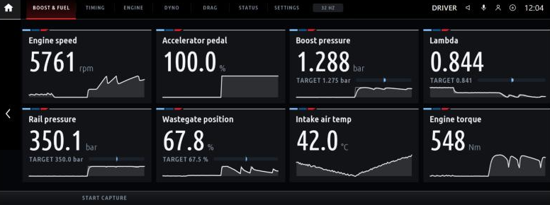
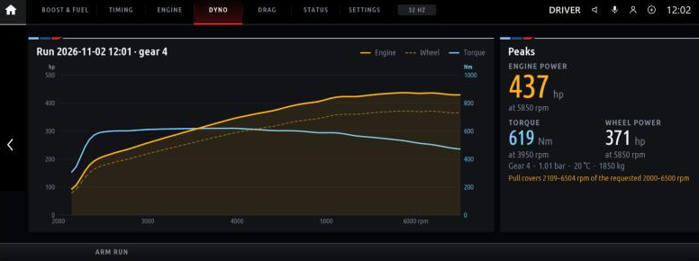
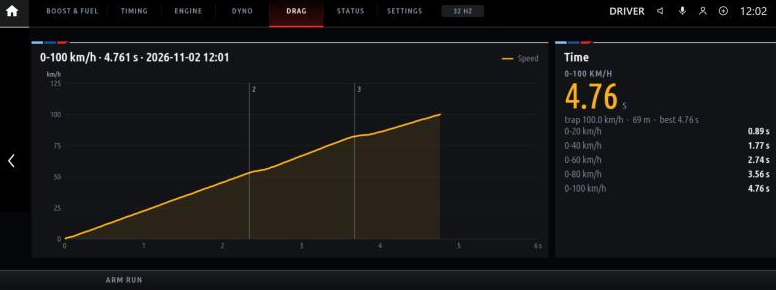

# Boostline for iDrive 7

**[Boostline](https://github.com/clucraft/Boostline)'s ECU logger, road dyno and drag timer running on the BMW iDrive 7 (MGU) head unit itself.** No laptop, phone, ENET cable or WiFi adapter: the head unit reads the engine computer (DME) over its own diagnostic link and shows live values, power curves and times on the centre display.

> **Status: proof of concept, not yet run on a car.** Everything below works in the emulator on a PC. Whether the real head unit passes Boostline's fast logging requests, and how fast it answers, is what the first test on a car has to show. See [What still needs a car](#what-still-needs-a-car).

> **You need a rooted head unit.** Apps like this run only on an MGU whose owner has root access. This project doesn't provide that or explain how to get it. Rooting can wipe the head unit's coding and, at worst, brick it. Back up your coding first.



Boostline is an independent community project. It is not affiliated with or endorsed by BMW. All trademarks belong to their owners.

---

## What it does

### Live data

- **Live tiles** on three pages (*Boost & fuel*, *Timing*, *Engine*):
  - Each tile shows the current value and a 12-second trace.
  - Actual/target pairs share a tile with a deviation bar: boost, lambda, rail pressure, wastegate, throttle and VANOS.
  - Units are bar/psi/kPa, °C/°F, km/h/mph and lambda/AFR.
- **Start capture** writes a Boostline CSV log to the app's data folder. The desktop app's log viewer, dyno and drag tools open it. Optionally, every full-throttle pull is captured automatically.
- **Status page:** VIN, DME software, diagnostic index, which BMW DME data is in use, sample rate, the diagnostic link's request counts, and Boostline's log.

### Dyno (road dyno)



1. On the *Dyno* page, press **Arm run**.
2. Do a full-throttle pull in one gear (3rd or 4th), from below the start rpm (2000 by default) to past the end rpm (6500 by default).

Boostline detects the pull and the gear on its own. It estimates engine power, wheel power and torque against rpm from the car's acceleration, and shows the peaks with the gear, air pressure and outside temperature.

- **Weather:** the air pressure and outside temperature are read from the car when you arm. Optional SAE J1349 or DIN 70020 correction.
- **Comparison:** the previous run is drawn dashed for comparison.
- **Re-analysis:** changing a dyno setting (weight, drivetrain loss, air drag area, rpm range, correction) analyses the run shown again, as on the desktop.

### Drag



The run types are:

- 0–100, 100–200 and 200–300 km/h
- 0–60 and 60–130 mph
- 1/8 and 1/4 mile

How a run is timed:

- **Standing starts:** after Arm run, wait for the car to stop, then time from the first movement.
- **Rolling runs:** start when the car crosses the start speed.

The page shows:

- the time and the trap speed
- the distance
- the best time for that run type
- a split every 10 km/h (or mph)
- the speed trace with each shift and the gear it went into

**Speedometer correction:** *True speed vs. the car's* corrects the car's speed by a fixed percentage. Measure the percentage once against GPS.

### Runs and safety

- **Saved runs:** finished dyno pulls and drag runs are saved in the desktop app's format (`Dyno/<id>.json`, `Drag/<id>.json`). Copy those folders into Boostline's desktop data folder to see the runs there.
- **Closed courses only:** the first Arm run shows a one-time notice that has to be confirmed with a second press.

Like the desktop, the figures are estimates from the car's own data, not a calibrated dynamometer or timing gear.

### Boostline's own code

It uses **Boostline's own engine code**, not a copy. The [Boostline repository](https://github.com/clucraft/Boostline) is pulled in as a submodule, pinned to a release, and bundled for the head unit. That brings the desktop app's full read path to the car:

- the same channel set
- multi-DID batching
- dynamically defined DIDs (BMW's `STATUS_BLOCK_LESEN` style block reads)
- the OBD-II fallback
- BMW DME data
- the CSV format
- the dyno's and drag timer's detectors and analysis

## Read-only

Every request passes Boostline's read-only allowlist before it reaches the head unit's transport:

- `10` (default and extended session)
- `19`, `22` and `23`
- `2C` (temporary RAM definitions for fast logging)
- `3E`

Nothing codes, flashes or clears. The tests check that no other service ever reaches the transport.

**Only do full-throttle pulls on a closed course.**

## How it works

```
 app/main.js            the screens (the idrive7-apps kit: GPU renderer, tabs, settings)
 app/runs.js            dyno and drag runs: arming, Boostline's detectors, saved runs
     │
 app/boostline-core.js  Boostline's Session, EnetAdapter, UDS client, channels, CSV recorder
     │                  (bundled from vendor/boostline for the head unit's Node 8 by tools/bundle.js)
     │  core/hsfzOverTasu.ts: Boostline's HSFZ connection, swapped for the head unit's transport
     │
 app/tasu-link.js       UDS over TASU, on the kit's diagnostic module (kit/runtime/diag.js)
     │
 the head unit's diagnostic gateway (TASU, SOME/IP)  ──▶  DME 0x12
```

On a PC, the DME end is played by [`emu/fakeDme.ts`](emu/fakeDme.ts). It answers the same requests a DME would, with live values from Boostline's B58 simulator: idle, launch, a 4th-gear pull to the limiter, braking.

## Try it in the emulator

You need **Node.js 18+**, **Python 3** and **git**. No car, no head unit and no BMW software are needed.

```bash
git clone --recursive https://github.com/clucraft/boostline-idrive.git
```

```bash
cd boostline-idrive
```

```bash
npm install
```

```bash
npm run emu
```

Then open http://localhost:8077.

- **Controls:** the mouse is the touchscreen. The mouse wheel and `[` `]` turn the iDrive knob, `Enter` presses it, and the arrow keys push it.
- **Side panel:** settings, the app's buttons and its log.
- **Trying Dyno and Drag:** the simulated car repeats one drive cycle of about a minute: a stop, a launch to 190 km/h, a slow-down, cruising in 4th, then a 4th-gear pull to the limiter.
  - Arm *Drag* at any time: it times the next launch.
  - Arm *Dyno* after the launch, while the car slows down or cruises, and it captures the 4th-gear pull. Armed at a stop, it takes the 1st-gear launch as the pull, as the desktop app would.
- **Live reload:** saving a file in `app/`, `core/` or `vendor/boostline` rebuilds and restarts the app in about a second.
- **OBD-II only:** `npm run emu -- --obd-only` starts without the emulator's DME data, to see the standard OBD-II channels on their own.

`npm run setup` (also run by `emu`) does the following:

- applies [`patches/idrive7-apps`](patches/idrive7-apps) to the kit
- links `app/` into the kit as `apps/boostline`
- writes a clearly marked **placeholder** for BMW's SDK, because the kit's build expects one and the emulator never loads it

The patches let the emulator run on Windows (a named pipe instead of a Unix socket, `python` instead of `python3`), and let it answer diagnostic requests through `--diag <module>`.

### Tests

```bash
npm test
```

```bash
npm run test:node8
```

Both run the app's diagnostic path end to end: Boostline's Session → `tasu-link.js` → the kit's Diag → a stubbed transport → the fake DME. They cover:

- identification and DME data selection
- block reads over `2C 01`
- the read-only check
- CSV capture
- OBD-II only
- no answer from the DME
- the transport refusing requests
- the dyno and drag timer on Boostline's simulated drive cycle, run faster than real time:
  - the 4th-gear pull and its peaks
  - re-analysis with another weight
  - 0–100 km/h and 1/8-mile times, splits and shifts
  - the speedometer correction
  - runs saved in the desktop format

`test:node8` runs them on Node 8.17.0, as the head unit does. It downloads that Node release once from nodejs.org and checks it against the release's checksums.

## On a car

1. **Root the head unit and get BMW's app SDK from it.** The [idrive7-apps README](https://github.com/cauliflowermossgrape/idrive7-apps#31-get-the-sdk-from-your-unit) explains how to extract the SDK into `vendor/idrive7-apps/oap-sdk/` with `kit/tools/extract_sdk.js`, replacing the placeholder.
2. **Build the package:**

   ```bash
   npm run build:car
   ```

   This writes `dist/boostline@<version>.mgu`. It refuses to build with the placeholder SDK. The package contains BMW's SDK, so keep it for your own car and never publish it.
3. **Install it** with the kit's installer: `deploy/make-car-kit.sh` and `push-to-car.sh` / `push-to-car.ps1` in `vendor/idrive7-apps`, as its README describes. They also install the GPU renderer.
4. **For the full BMW channel set,** copy the DME data you imported in Boostline's desktop app into the app's data folder on the head unit:

   - from: `bmw-dme-data.json` in Boostline's settings folder
   - to: `/var/opt/public/oap/oap_<uid>/data/`

   Without it, the app reads the standard OBD-II channels.
5. **Logs** go to `/var/opt/public/oap/oap_<uid>/data/Logs/`. Copy them off with `scp` and open them in Boostline's desktop app. The app stops starting new captures once that folder holds about 96 MB. Its disk quota is 128 MB (`maxDiskUsage` in [`app/app.json`](app/app.json)).
6. **Dyno and drag runs** go to `Dyno/` and `Drag/` in the same data folder. Copy them into the desktop app's data folder (by default `Documents/Boostline`) to see them in its run lists.
7. **Before the first dyno run,** set your car's weight with driver and fuel, and its air drag area, in the app's settings.

## What still needs a car

The emulator answers the way the kit's code and Boostline's tests say a DME behind the head unit answers. Only a car can tell:

- **Speed:** how many samples per second the head unit's transport delivers. The emulator's ~32 per second comes from an assumed 6 ms per request, so it says nothing about the car.
- **Block reads:** whether the transport passes `2C` (dynamic DIDs) and `10 03` (extended session). If it doesn't, Boostline falls back to plain multi-DID reads by itself, and the Status page's log says so.
- **Head unit behaviour:** BMW's own menus and popups, and running on the car's slower processor.
- **Dyno and drag precision:** both interpolate between samples, but they're only as good as the sample rate and the speed signal.
  - With BMW DME data, speed comes from the DME's own measurement.
  - Without it, the standard OBD-II speed is whole km/h and stops at 255 km/h, which is coarse for drag times.
  - The head unit also receives the car's speed at 20 Hz in steps of 1/64 km/h. Using that signal for the drag timer is a possible improvement once the car test shows what the DME delivers.

The first test on a car is the speed test: drive with the Status page open, then compare its sample rate and request counts with an MHD or ENET log of the same channels.

## Known gaps

- The CSV's `adapter` line reads `ENET · tasu`. It comes from Boostline's ENET adapter, which the head unit reuses. A proper head-unit adapter kind in Boostline would fix it, together with replacing the build-time HSFZ swap with a transport option in Boostline itself.
- The emulator patches are kept here as patch files. They belong upstream in idrive7-apps.

## Repository layout

```
app/                  the head-unit app: app.json, main.js (screens), runs.js (dyno and drag),
                      tasu-link.js (+ boostline-core.js, generated)
core/                 the bundle's entry and the head-unit glue: index.ts, hsfzOverTasu.ts,
                      headUnitRuntime.ts, polyfills.ts (Node 8)
emu/fakeDme.ts        the emulator's DME (invented DIDs, Boostline's simulator)
patches/idrive7-apps/ emulator on Windows + diagnostics hook, applied by tools/setup.js
test/run.js           end-to-end tests of the diagnostic path (Node 8 and current)
tools/                setup.js, bundle.js, emu.js, build-car.js, node8.js
vendor/boostline      submodule: Boostline, pinned to a release tag
vendor/idrive7-apps   submodule: the MGU app kit, emulator and installer
```

## Licence

MIT, like Boostline and the idrive7-apps kit. See [LICENSE](LICENSE).

- The submodules keep their own licences. The kit's GPU renderer and the emulator's draw engine are GPL-3.0-or-later.
- BMW's app SDK and BMW DME data are BMW's. Neither is in this repository, and neither may be published.
- The fake DME's DIDs, scalings and diagnostic index are invented for the emulator; they are not BMW data.
